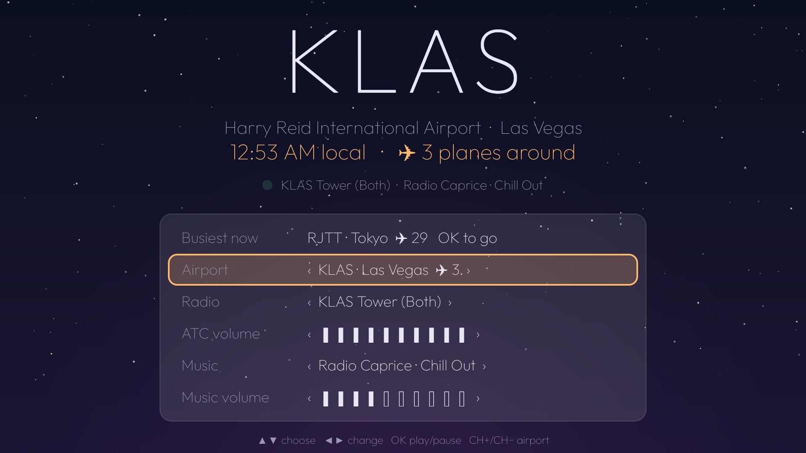
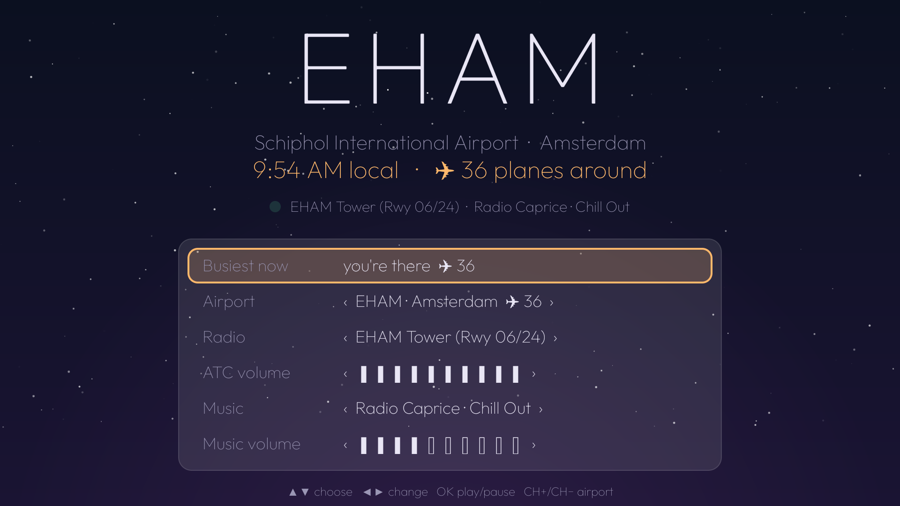

# Lofi ATC

Ad-free lofi music with live air traffic control radio on top, for a PC browser, an Android TV, or any
screen on your home network. Inspired by lofiatc.com, which went offline.



## What it does

- **Live tower and approach radio** from 17 airports (Las Vegas, San Francisco, San Jose, New York,
  Amsterdam, Tokyo, Sydney and more) via [LiveATC.net](https://www.liveatc.net).
- **Soft lofi playlist**: 69 calm, mellow chill-hop tracks (over three hours, by Purrple Cat,
  < e s c p >, Ghostrifter and others), shuffled, with the song and artist on screen. All Creative
  Commons, see [MUSIC-CREDITS.md](MUSIC-CREDITS.md).
- **13 ad-free radio stations**: lofi, trip-hop, downtempo, chillsynth, vaporwave and mellow mixes.
- **Busiest airport finder**: counts the planes in the air or taxiing within 20 nm of each airport
  ([adsb.fi](https://adsb.fi) open data), so you can jump to the one with the most radio chatter.
- **Talk light** that glows while a controller or pilot is speaking.
- Separate volume for radio and music. A dead radio channel is skipped automatically.

## Install it (no technical knowledge needed)

### Windows PC

1. Download **[Lofi-ATC-Setup.exe](https://github.com/Swainsteiger/lofi-atc/releases/latest/download/Lofi-ATC-Setup.exe)**.
2. Open the downloaded file. Windows may show **"Windows protected your PC"**: this appears for apps
   from small independent developers that haven't paid for a code-signing certificate. Click
   **More info**, then **Run anyway**.
3. Click **Install**. No administrator password is needed.
4. Open **Lofi ATC** from the desktop icon or the Start menu. It opens in its own window; click the
   round play button if it doesn't start by itself.

To remove it: Settings → Apps → Installed apps → Lofi ATC → Uninstall.

### Android TV / Google TV

1. On the TV, open the **Google Play Store**, search for **Downloader** (by AFTVnews) and install it.
2. Open Downloader. When asked, allow it to access files.
3. In the address box, type this and press Go:
   `https://github.com/Swainsteiger/lofi-atc/releases/latest/download/Lofi-ATC-TV.apk`
4. When it finishes downloading, choose **Install**. If the TV says installing from this source isn't
   allowed, it offers a shortcut to **Settings**: turn on **Allow from this source** for Downloader,
   go back and choose Install again.
5. **Lofi ATC** now appears with your other apps. Downloader can be uninstalled afterwards.

## Run from source

### PC (any browser)

Needs Python 3 (standard library only).

```
python pc/serve.pyw
```

This serves the page at `http://127.0.0.1:8770`, opens it as an app window in Chrome or Edge (or your
default browser), and fetches the plane counts that a browser can't fetch on its own. It quits ten
minutes after the last page is closed.

To let other devices on the same Wi-Fi (a tablet, an old smart display) open it at
`http://<your-pc-ip>:8770`, start it with `python pc/serve.pyw --lan`. Windows may ask to allow it
through the firewall.

Keyboard: Space play/pause, ←/→ airport, ↑/↓ radio channel, M music, B busiest airport.

`build-windows.ps1` builds the Windows installer (`dist\Lofi-ATC-Setup.exe`) with Python bundled in,
using PyInstaller and [Inno Setup 6](https://jrsoftware.org/isinfo.php).

### Android TV



An Android TV app (Android 8+), built with Gradle and ExoPlayer:

```
cd tv
./gradlew assembleRelease
adb install -r app/build/outputs/apk/release/app-release.apk
```

It shows up as **Lofi ATC** in the TV's apps. On the remote: ▲▼ choose a row, ◀▶ change it, OK
play/pause, CH+/CH− airport. OK on **Busiest now** jumps to the busiest airport. The release build is
signed with the debug key, for sideloading.

### Changing airports or stations

The lists live in `make_airports.py` (`STATIONS` for radio stations, `POS` and `TZ` for airport location
and time zone). The airport feed lists come from lofiatc.com's `/airport/<icao>` JSON; save one per
airport into a folder, then run

```
python make_airports.py <folder>
```

It rewrites `airports.json`, `stations.json`, `pc/data.js` and the TV app's assets (without a folder it
keeps the airports and only refreshes the music). Rebuild the TV app afterwards. `make_icon.py` redraws
the icon and TV banner (needs Pillow).

### Changing the Soft lofi playlist

The tracks are listed in `music/source.json`; only CC BY and CC BY-SA tracks belong there. Download each
one with its **Free Download** button on free-stock-music.com into `music/downloads` (the site doesn't
allow direct downloads), then run `python music/build_music.py` (needs ffmpeg). It converts them to
128 kbps and writes `music/tracks.json` and `MUSIC-CREDITS.md`. Upload `music/build/*.mp3` to the
`music-v1` release (or a new tag, changing `RELEASE` in the script), then run `python make_airports.py`.

## Credits and fair use

- ATC audio: [LiveATC.net](https://www.liveatc.net). Their streams are offered for personal listening;
  this project plays them in your own browser or app and does not rebroadcast them. It is not
  affiliated with or endorsed by LiveATC.net or lofiatc.com.
- Plane counts: [adsb.fi](https://adsb.fi) open data, at most one request a second.
- Soft lofi playlist: 69 tracks by Purrple Cat, < e s c p >, Ghostrifter Official, Alex-Productions,
  Schematist and others, under CC BY and CC BY-SA licenses, found via
  [free-stock-music.com](https://www.free-stock-music.com). Every track, artist and license is listed in
  [MUSIC-CREDITS.md](MUSIC-CREDITS.md) and shown on screen while it plays. The licenses of these tracks,
  not this project's MIT license, apply to them.
- Radio: [Radio Caprice](http://radcap.ru), [Nightride FM](https://nightride.fm),
  [Nightwave Plaza](https://plaza.one) and [Radio Paradise](https://radioparadise.com), all
  commercial-free. Support them if you enjoy them.
- Font: [Outfit](https://github.com/Outfitio/Outfit-Fonts), SIL Open Font License 1.1.

Code: MIT, see `LICENSE`. The Outfit font files are not covered by it; they are under the SIL Open Font
License 1.1, see `FONT-LICENSE-OFL.txt`.
